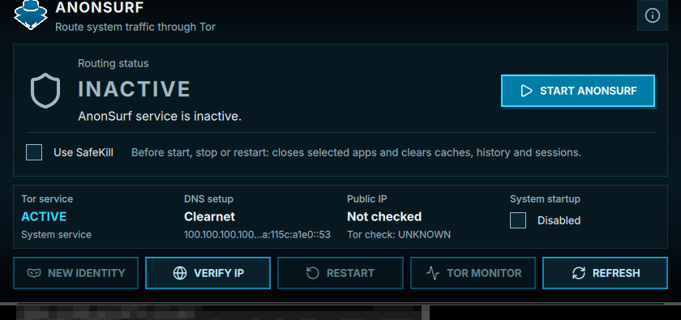

# AnonSurf GUI Builder

Build and install the **official ParrotSec AnonSurf 6 GUI** (Qt6/QML) from
source on MX Linux / Debian 13 (trixie).



AnonSurf routes your whole system through Tor with one click. The GUI gives
you a dashboard: routing state, Tor service, DNS setup, public IP check,
new identity, startup toggle and a Tor monitor.

## Why this exists

There is **no prebuilt `.deb` you can download**. ParrotSEC publishes packages
to a GitLab package registry that requires a sign-in, and the web download
redirects to the login page. So this helper builds the official source
instead — same code, same license.

- Upstream: <https://gitlab.com/parrotsec/packages/anonsurf>
- Upstream license: **GPL-2.0**
- This repo is an unofficial build helper. It vendors **no** upstream source;
  it clones it at build time.

## Requirements

- Debian 13 (trixie) / MX 25.x, amd64
- `sudo`, internet access
- ~391 MB free disk for build dependencies

## Quick start

```bash
git clone https://github.com/Ryuupyroxi/anonsurf-gui-builder.git
cd anonsurf-gui-builder
./build-anonsurf-gui.sh
```

Then launch `anonsurf-gui` or find **AnonSurf GUI** in your application menu.

## What gets installed

| Path | Purpose |
|------|---------|
| `/usr/bin/anonsurf-gui` | Qt6/QML dashboard |
| `/usr/bin/anonsurf` | Go CLI (`anonsurf start\|stop\|status\|ip\|changeid\|monitor\|boot`) |
| `/usr/lib/anonsurf/` | `anondaemon`, `dnstool`, `make-torrc`, `safekill` |
| `/etc/anonsurf/` | bridges, onion.pac, config |
| `/usr/share/applications/` | menu entries (GUI + CLI) |
| systemd | `anonsurfd`, `anonsurf-recovery`, `anonsurf-identity` |

Your previous AnonSurf files are backed up to
`~/anonsurf-backup-<timestamp>/` before anything is overwritten.

## WARNING — starting AnonSurf cuts your network

Pressing **START ANON SURF** routes **all TCP + DNS through Tor** and blocks
public UDP. That means:

- **Tailscale (UDP) stops working** — SSH over Tailscale drops.
- Anything not on your LAN loses connectivity until you press STOP.
- The GUI keeps working while AnonSurf runs (it talks to systemd over
  loopback, which is excluded from the tunnel).

`anonsurf-recovery.service` runs at boot and restores your previous network
settings if a session was ever interrupted — it is a no-op otherwise.

## Using the GUI

- **START ANON SURF / STOP ANON SURF** — enable or disable routing
- **VERIFY IP** — check the public IP seen for that request
- **NEW IDENTITY** — request new Tor circuits for future connections
- **RESTART** — restart routing
- **TOR MONITOR** — opens Nyx (install the `nyx` package first)
- **Use SafeKill** — close listed apps and clear caches before start/stop

## Install tips

- **Be patient on old CPUs** — the Qt6 GUI compile is the slow part. On a
  2009 dual-core it takes roughly 10-15 minutes; the Go binaries finish fast.
- **Don't start it until you mean it.** Installing changes nothing, but
  pressing START cuts your LAN/WAN/UDP access (see the warning above).
- **Closing the window does not stop routing.** The GUI docks to the system
  tray; use STOP ANON SURF (or `anonsurf stop`) to get your network back.
- **Launch it** from the application menu (**AnonSurf GUI**) or run
  `anonsurf-gui` in a terminal.
- **Prefer the terminal?** Every GUI action has a CLI equivalent:
  `anonsurf start`, `anonsurf stop`, `anonsurf status`, `anonsurf ip`,
  `anonsurf changeid`, `anonsurf monitor`, `anonsurf boot enable`.
- **Check it is really working** with VERIFY IP in the GUI, or run
  `anonsurf ip` and `anonsurf status`.
- **SafeKill is optional and destructive** — it closes listed applications
  and wipes their caches/history. Leave it off unless you want that.
- **Troubleshooting** — `anonsurf status` shows routing/Tor/DNS state and
  `journalctl -u anonsurfd` shows the service log. If the network ever gets
  stuck, reboot: `anonsurf-recovery.service` restores the previous settings.
- **Prebuilt binaries** (no compiling) are attached to the GitHub Releases
  page for MX/Debian trixie amd64.
- **Uninstall** with `sudo make uninstall` from the source directory, or
  remove the paths listed above.

## Cleaning up the build dependencies

The build tools are only needed to compile. Reclaim ~391 MB with:

```bash
sudo apt-get remove --auto-remove cmake golang-go qt6-declarative-dev fonts-inter
```

## License

Upstream AnonSurf is **GPL-2.0**; see [LICENSE](LICENSE). The build script and
documentation in this repository are provided under the same terms.
